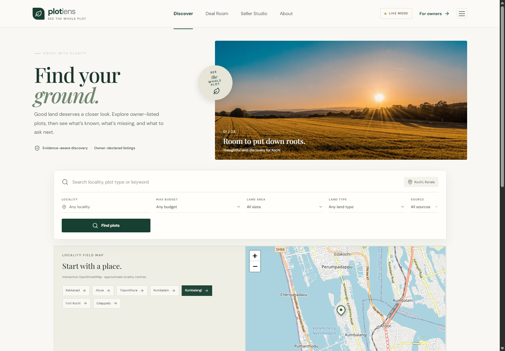
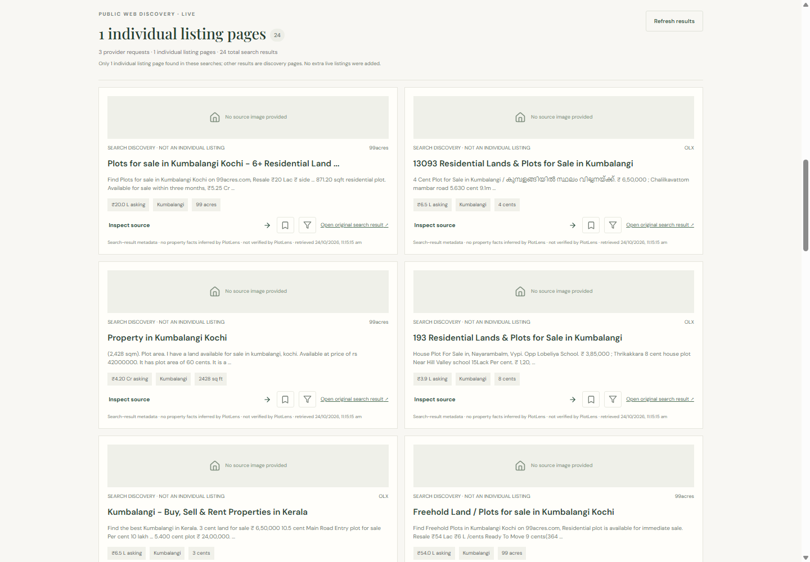
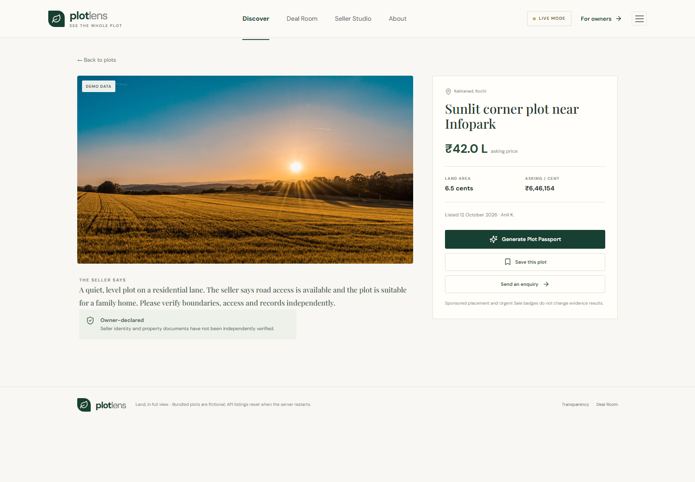
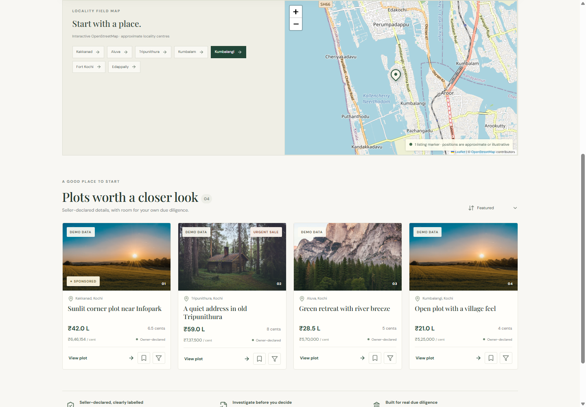
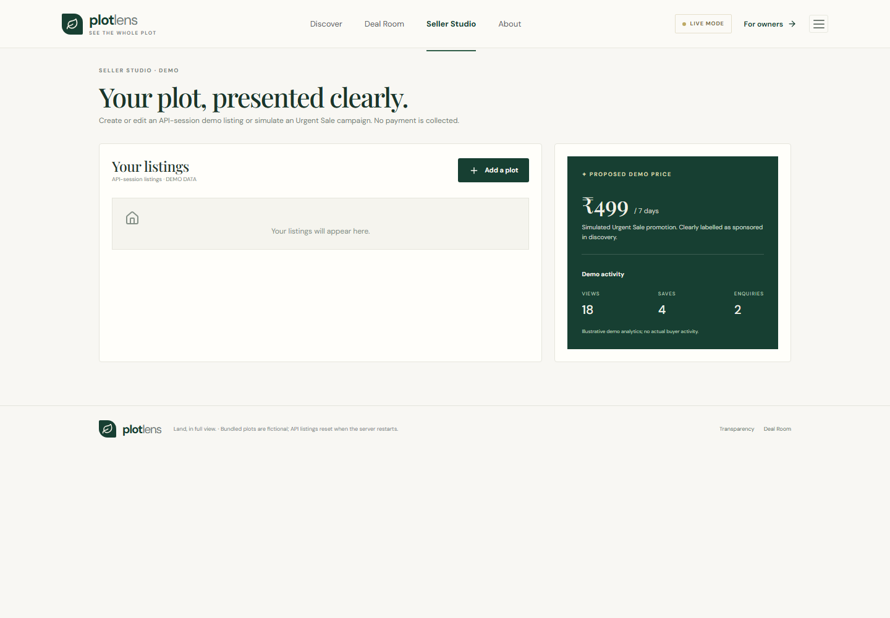

# PlotLens AI

**Explore land listings. Follow the evidence. Know what still needs checking.**

PlotLens AI is a Kerala-focused property discovery and due-diligence prototype for people exploring land, starting with Kochi-area localities. It combines clearly labeled demo listings, linked public search results, an interactive locality map, and an evidence-oriented investigation workflow for questions such as waterlogging, drainage, and missing property evidence. It helps buyers organize preliminary research; it does not verify property facts or replace professional due diligence.

## Idea and problem

Property information is fragmented across listing portals and public pages. Listings can be incomplete or stale, and early research into local conditions is difficult to connect to a specific plot. PlotLens brings discovery, source links, location context, and investigation questions into one workflow. It records evidence and gaps so buyers can decide what to verify next, while keeping locality context distinct from parcel-level proof.

## Product demo

**Hosted demo:** No publicly accessible deployed demo is configured or documented in this repository. The GitHub repository is the source code, not a hosted product.

To publish a demo, deploy the Express API as a Node service, set provider credentials in that host's secret settings, deploy the Vite production frontend (`dist/`) to a static host, and configure the public frontend host to route `/api` requests to the API service. The current Vite proxy is development-only. Add the verified public URL here after deployment and confirm it loads without exposing credentials.

## Screenshots

These are genuine captures of the running application. Public discovery showed 24 provider results across three searches, including one result classified as an individual detail page at capture time; live results vary. Demo listing content remains labeled in the interface.

| Screen | Screenshot |
| --- | --- |
| Home and locality search |  |
| Public property discovery |  |
| Listing details |  |
| Locality map |  |
| Seller Studio |  |

No Plot Passport screenshot is included because no existing investigation report was available to capture without starting a new provider investigation.

## Key features

| Feature | Status and scope |
| --- | --- |
| Locality discovery | Native fictional demo fixtures plus API-session listings. |
| Public property search | Optional SerpApi integration, up to three queries, source links and supported result metadata. Individual detail pages are distinguished from broader discovery pages. |
| Plot Passport investigation | Bounded locality searches and optional OpenAI analysis; trace, source register, evidence gates, waterlogging scope, unresolved checks and limitations. |
| Map | Leaflet/OpenStreetMap tiles; approximate locality markers unless verified coordinates were explicitly supplied. |
| Buyer tools | Save, compare, notes, checklists and report history in the current browser's `localStorage`. |
| Seller Studio | Create/edit/mark-sold listing prototype; API-session data, simulated promotion and illustrative analytics. |

## Technology stack

| Area | Technologies in this repository |
| --- | --- |
| Frontend | React 18, TypeScript 5.7, Vite 6, Tailwind CSS 3, Lucide React |
| Backend | Node.js, Express 4, TypeScript, Zod, dotenv |
| AI and search | OpenAI Node SDK (Responses API structured output), SerpApi search adapter |
| Mapping | Leaflet 1.9, React Leaflet 4, OpenStreetMap tiles |
| Storage | In-process API arrays/maps and browser `localStorage`; no database |
| Testing | Vitest 2, Supertest |
| Development/build | npm scripts, Vite, TypeScript, PostCSS, Autoprefixer, Tailwind CSS |

Versions above reflect declared package ranges; `package-lock.json` records the resolved dependency tree.

## Architecture

The React client calls the Express API. The API validates requests, manages short-lived in-memory caches, and calls optional external search/AI providers from the server. See [System Architecture](docs/SYSTEM_ARCHITECTURE.md) for component and Mermaid flow diagrams, and [API Reference](docs/API_REFERENCE.md) for routes and schemas.

## Local setup

Requirements: Node.js 20+ and npm. From the repository root in PowerShell:

```powershell
npm install
Copy-Item .env.example .env
# Edit the root .env locally if provider access is needed.
npm run dev
```

Open `http://localhost:5173`. The Express API listens on `http://localhost:3001`; Vite proxies `/api` to that address during development. `npm run dev` starts both. For separate terminals, run `npm run dev:server` and `npm run dev:web`.

The backend loads the root `.env` through `import 'dotenv/config'` in `server/index.ts`. Never commit `.env` or put provider credentials in frontend code.

### Environment variables

| Variable | Purpose |
| --- | --- |
| `PORT` | Optional API port (default `3001`). |
| `SERPAPI_API_KEY` | Enables external property discovery and investigation searches. |
| `OPENAI_API_KEY` | Enables model analysis. |
| `OPENAI_MODEL` | Required with the key; must be available to the account and support the Responses API structured output used here. No model default is assumed. |
| `GOOGLE_MAPS_API_KEY` | Read for configuration status; no Street View panorama is implemented and this value is not sent to the browser. |
| `PROPERTY_SEARCH_DOMAINS` | Optional comma-separated preferred search domains, validated and capped at eight. |

Blank placeholders are in `.env.example`. Demo/limited/live mode describes provider configuration, not whether an individual request succeeded. Search and report responses carry request outcomes and cache information.

## Tests and production build

```powershell
npm test
npm run build
npm start # after building; starts the compiled API
```

The test suite mocks providers and does not require live API calls. The build checks TypeScript, bundles the Vite frontend, and checks the server TypeScript project. `npm start` serves the compiled API; production hosting must separately serve the static frontend and route `/api` to the API.

## Data, provenance, and limitations

- Seed listings are fictional and labeled demo data. Seller-submitted values are declarations, not independent verification.
- External results contain provider result metadata and original URLs; PlotLens does not scrape full pages or invent missing prices, areas, locations, or source images.
- Public search uses up to three SerpApi queries. Responses are cached in server memory for one minute; `refresh=1` bypasses that cache. Cached records retain their original retrieval timestamps.
- Investigation records source URLs, snippets, queries and retrieval times. A locality mention is context, not parcel-specific evidence. Missing evidence does not establish safety.
- The map uses approximate locality centres unless verified coordinates are explicitly supplied. A map marker does not verify parcel boundaries.
- API listings/reports reset when the server restarts. Browser-saved state and notes remain local to that browser profile.
- No authentication, authorization, rate limiting, durable database, title/ownership checks, official land-record integration, parcel flood verification, payment processing, or measured buyer analytics is implemented. CORS is currently permissive; add appropriate protections before public production use.
- PlotLens does not establish title clearance, ownership, access rights, zoning, flood safety, market value, or investment outcomes. Consult relevant authorities and qualified local legal/survey professionals before a transaction.

## Documentation and project status

- [Project status and pending work](docs/PROJECT_STATUS.md)
- [System architecture](docs/SYSTEM_ARCHITECTURE.md)
- [API reference](docs/API_REFERENCE.md)
- [Risk investigation sprint notes](docs/RISK_INVESTIGATION_SPRINT.md)
- [Build and prior verification notes](BUILD_STATUS.md)
- [Contributing](CONTRIBUTING.md) · [Security](SECURITY.md)

No `LICENSE` file or license selection exists in this repository; licensing remains unspecified.

## Acknowledgments

The map uses [OpenStreetMap](https://www.openstreetmap.org/copyright) data and tile infrastructure with attribution. SerpApi and OpenAI are optional server-side integrations. External listing portals are the source of their linked pages; PlotLens is not affiliated with them.
