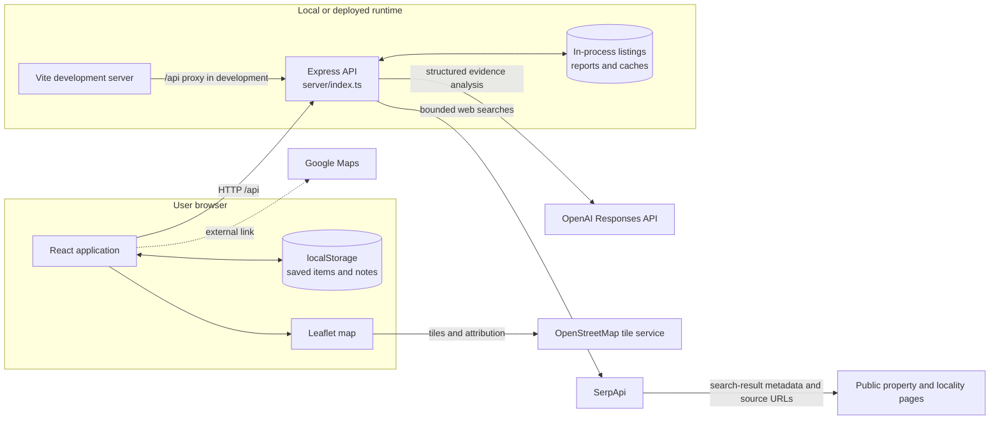

# System Architecture

## System context



Vite's `/api` proxy is configured for development at `http://localhost:3001`. The Express server listens on `PORT` or `3001`. In the production build, the frontend is static output and requires hosting plus a reverse proxy or equivalent API routing; no deployment platform is configured in this repository.

## Components and responsibilities

| Area | Files | Responsibility |
| --- | --- | --- |
| React application | `src/main.tsx`, `src/App.tsx`, `src/styles.css` | Navigation, discovery, detail views, seller prototype, investigation/report views, browser persistence, API calls. |
| Map and locality | `src/PlotMap.tsx`, `src/locations.ts` | Leaflet map, OSM tile layer, locality centres, marker selection. Coordinates are parcel-verified only when input explicitly carries `precision: "verified"`; otherwise locality display is approximate. |
| API and validation | `server/index.ts`, `server/types.ts` | Express routes, CORS/JSON middleware, Zod validation, provider configuration status, memory caches and error envelopes. |
| Catalogue | `server/listings.ts` | Seed demo listing fixtures and filtering/sorting helpers. New API-session listings are held in a server array. |
| Public discovery | `server/providers/property-search.ts`, `server/providers/serpapi.ts` | Bounded SerpApi search, URL canonicalization, duplicate removal, result classification, supported metadata extraction, source provenance. |
| Investigation | `server/investigation/controller.ts`, `server/investigation/evidence.ts`, `server/investigation/risk-investigation.ts` | Query planning, evidence normalization and gates, report trace, coverage and waterlogging risk scope. |
| AI adapter | `server/providers/openai.ts` | Calls OpenAI Responses API for structured analysis when both credential and model are configured; output is validated and gated against evidence. |
| Tests | `server/**/*.test.ts`, `src/locations.test.ts` | API, provider normalization, AI validation, evidence/risk logic, and locality behavior. |

## Search flow

1. The React client sends locality/search terms and optional filters to `GET /api/property-search`.
2. Express validates the query, obtains matching native demo/API-session listings, and uses a one-minute in-memory cache keyed by query, filters, and configured domains. `refresh=1` bypasses this cache.
3. When `SERPAPI_API_KEY` is absent, the API returns native data with an empty external result set and a configuration message. It does not create substitute live-looking results.
4. With SerpApi configured, the search adapter makes at most three bounded queries concurrently. Results are deduplicated by canonical URL and capped at 40.
5. Normalization retains provider URL, source/domain, query, retrieval time, snippet and supported price/area/locality only. Individual listing detail pages are distinguished from broader search/discovery pages. No full page is scraped and no missing value is inferred.
6. The response marks cache state, provider request counts/failures, domains, individual listing count, mode, and any partial-provider message. The UI presents source and missing-field labels and links to original URLs.

## Plot Passport / investigation flow

```mermaid
sequenceDiagram
  actor Buyer
  participant UI as React application
  participant API as Express API
  participant Controller as Investigation controller
  participant Search as SerpApi adapter
  participant Gate as Evidence normalization and gates
  participant AI as OpenAI Responses API
  Buyer->>UI: Select listing, concerns, generate passport
  UI->>API: POST /api/passport
  API->>API: Validate subject and concerns; check one-minute report cache
  API->>Controller: investigate(subject, concerns, providers)
  Controller->>Controller: Plan up to three locality searches
  loop Each planned search (maximum three)
    Controller->>Search: Search query
    Search-->>Controller: Search result metadata or provider error
  end
  Controller->>Gate: Normalize, deduplicate, associate evidence
  Gate-->>Controller: Evidence records and provenance
  opt OpenAI key and model configured; locality available
    Controller->>AI: Analyze listing, checks and normalized evidence
    AI-->>Controller: Structured claims and buyer questions
  end
  opt Follow-up conditions met
    Controller->>Search: One targeted follow-up (maximum one)
    Search-->>Controller: Additional records or provider error
  end
  Controller->>Gate: Apply evidence ID, relevance, locality/parcel specificity and conflict gates
  Gate-->>Controller: Gated claims, coverage and water-risk scope
  Controller-->>API: Report with events, evidence, limitations and outcomes
  API-->>UI: JSON report; retain in process memory
  UI-->>Buyer: Investigation trace and source-linked report
```

Search and model calls are conditional. Without locality, the controller skips location-specific search and analysis rather than inferring a place. It runs at most three initial investigation searches and one targeted follow-up. A one-minute in-memory cache and in-flight request map reduce repeated identical work. A maximum of 20 recent reports are retained in server memory.

Evidence entries include source URL, title/snippet, publication date when supplied, retrieval timestamp, query, source type, claim links, origin and provenance. Deterministic gates validate evidence IDs, relevance, scope and conflicts; model output alone does not establish a fact. A locality source may be shown as context but cannot prove a parcel-specific flood condition. Waterlogging reports explicitly preserve scope, status and unresolved physical/document checks.

## Maps, save/compare, and seller features

- `src/PlotMap.tsx` uses Leaflet and public OpenStreetMap tiles. Verified coordinates may come from an explicitly precision-tagged listing; other supported locations use locality centres, which are approximate. Results without a supported locality are not placed as property markers.
- Google Maps links open externally using locality or supported coordinates. `GOOGLE_MAPS_API_KEY` currently affects only a configuration boolean; the API reports that panorama embedding is not configured and does not send this key to the browser.
- Saved listing IDs, comparison selection, Deal Room notes/checklists, and report history are held in browser `localStorage` as implemented in `src/App.tsx`. These are browser-local, not user accounts or synchronization.
- Seller Studio creates/updates/marks listings through the API, but those records live only for the server process session. Promotion is simulated and analytics are illustrative, not measured marketplace activity.

## Configuration, modes, and security boundaries

`server/index.ts` imports `dotenv/config`, which loads the root `.env` when the backend process starts. Variable names are listed in the root `.env.example`. API keys are read server-side and are not included in health responses; status exposes booleans. Demo/limited/live mode describes configuration, not request success. Individual endpoint responses and investigation events describe actual cache/provider outcomes.

The API currently uses unrestricted `cors()` and has no authentication, authorization, rate limiting, durable database, or secret manager. JSON request bodies are limited to 32 KB and inputs are Zod-validated. This is a prototype boundary, not a production security posture. Treat external search snippets as untrusted/incomplete provider data and preserve original source links.

## Storage and limitations

There is no database. Seed fixtures are in source; seller-created listings, reports, and caches are process-memory only and reset on server restart. Browser `localStorage` is specific to the current browser profile. No production deployment configuration is present. Official title/ownership, survey/boundary, zoning, drainage, elevation, and parcel risk data sources are not integrated. See [Project Status](PROJECT_STATUS.md) and [Risk Investigation Sprint](RISK_INVESTIGATION_SPRINT.md).
